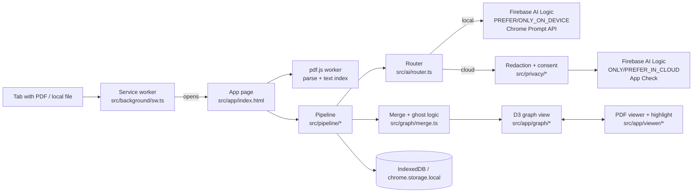

# Design — Archive Séance (档案通灵板)

Status: draft v1, 2026-11-21. Covers requirements R1–R16 (see `requirements.md`). Items marked **[VERIFY]** are facts I could not fully confirm from documentation on 2026-11-21 and must be tested in the 11/21 spike before being relied on.

## 1. Principles

1. **AI judges, code computes.** The model is used for language judgment (who is mentioned, what relation a snippet states, whether two contexts look like the same person). Code computes offsets, counts, similarity, confidence, routing, redaction, clustering, layout.
2. **Every claim has evidence.** No node or edge exists without a located quote (page + offsets).
3. **Privacy by default, human in the loop.** Documents start `sensitive` (on-device only). Cloud use is per document, after a consent dialog showing the exact payload. Merges are suggestions the user confirms.
4. **Pure core, thin shell.** Router, redaction, merge, locator, span mapper are pure TypeScript with property-based tests; the extension shell only wires them.

## 2. Verified platform facts (as of 2026-11-21)

| Fact | Source |
|---|---|
| Hybrid inference on web needs Firebase JS SDK ≥ 12.5.0 and Chrome Desktop ≥ 139. Hybrid via Chrome Prompt API is GA since SDK 12.14.0 (2026-05-28). Latest on npm today: `firebase@13.4.0`. | Firebase hybrid docs, JS release notes, npm |
| Modes (enum `InferenceMode`): `PREFER_ON_DEVICE`, `ONLY_ON_DEVICE`, `PREFER_IN_CLOUD`, `ONLY_IN_CLOUD`. Value strings: `"prefer_on_device"` etc. | Firebase docs + `@firebase/ai` typings (checked in `firebase@13.4.0`) |
| `getGenerativeModel(ai, hybridParams)` takes `{ mode, onDeviceParams?, inCloudParams? }`. Config is fixed for the lifetime of a model instance, so use one instance per (mode, schema) pair. | Firebase docs + typings |
| `GenerativeModel.initializeDeviceModel(onProgress?)` must be called after a user interaction and before inference. With `PREFER_ON_DEVICE`, calls made before the download finishes fall back to cloud; with `ONLY_ON_DEVICE` they wait or error. | typings doc-comment + docs |
| Response property `response.inferenceSource` is `"on_device"` or `"in_cloud"` (constant `InferenceSource.ON_DEVICE` / `IN_CLOUD`). | typings |
| On-device supports single-turn text, JPEG/PNG image input, JSON/enum structured output. No chat, no tools, no PDF/audio input, no count-tokens. | Firebase docs |
| Structured output in hybrid: set `onDeviceParams.promptOptions.responseConstraint` AND `inCloudParams.generationConfig.{responseMimeType:'application/json', responseSchema}`. | Firebase hybrid structured-output page |
| Default cloud model in hybrid is `gemini-3.5-flash-lite` (SDK ≥ 13); override with `inCloudParams.model`. | Firebase docs |
| Prompt API works in extension contexts (service worker, popup, side panel, extension pages) without extra manifest permissions from Chrome 138; remove the expired `aiLanguageModelOriginTrial` permission. Hardware: ≥ 22 GB free disk, GPU > 4 GB VRAM or CPU with ≥ 16 GB RAM and ≥ 4 cores. | Chrome Prompt API docs |
| App Check is auto-enforced for AI Logic (Firebase says enforcement was applied to all projects on 2026-11-02). Dev: `self.FIREBASE_APPCHECK_DEBUG_TOKEN = true` (or a token string) before `initializeAppCheck`; register the printed token under Console → App Check → Apps → Manage debug tokens. Never commit it. | Firebase docs |
| The Firebase web SDK's reCAPTCHA provider injects remote scripts, which Chrome Web Store rejects for MV3 ("Blue Argon"). | Chrome RHC doc + community report |
| Remote Config web SDK needs IndexedDB; the official environment table does not list Chrome extensions as supported; guard with `isSupported()`. | Firebase env table + API ref |
| On-device multimodal needs flag `chrome://flags/#prompt-api-for-gemini-nano-multimodal-input` (per Firebase doc); text-only may not. | Firebase doc **[VERIFY text-only on current stable]** |

### Open items to verify in the 11/21 spike (record outcomes in `docs/SPIKE_RESULTS.md`)

- **[VERIFY-1]** `getGenerativeModel` hybrid + `initializeDeviceModel()` + App Check debug token all work in a **MV3 extension page** (not only on localhost).
- **[VERIFY-2]** Actual Gemini Nano input limit (tokens) in this Chrome build. The Firebase doc cites 9,216 tokens for on-device multimodal prompts; token counting is not available through Firebase, so chunk by characters and tune `routeLocalMaxChunkChars` empirically. Default 6000 chars is a guess.
- **[VERIFY-3]** Remote Config in an extension page (IndexedDB inside `chrome-extension://` origin). If it fails: compiled defaults, bonus dropped.
- **[VERIFY-4]** Structured output via `responseConstraint` actually constrains Nano reliably for the extraction schema; if not, parse defensively and drop invalid items (already required by R3.3).
- **[VERIFY-5]** The exact `hooks` trigger names in the installed Kiro version (docs show both `PostFileSave` in the schema example and "File Save" in the trigger table). Create each hook through "Ask Kiro" once and commit the JSON Kiro generates.

## 3. Architecture



Key decision: **all AI and pipeline work runs in the app page** (a normal extension page opened in a tab), not in the service worker. Reasons: (a) `initializeDeviceModel()` needs a user gesture in a page; (b) MV3 service workers are killed after ~30 s of idleness, which breaks multi-minute extraction; (c) pdf.js, D3 and the viewer need a DOM anyway. The service worker only handles the toolbar click, the context menu, and host-permission handoff. (Firebase added service-worker support in the SDK in Aug 2026, but we do not depend on it.)

### 3.1 Module map (paths are normative; Kiro tasks reference them)

```
/
├─ .kiro/                        (committed; NEVER gitignored)
├─ docs/{PRIOR_ART.md,DEMO_SOURCES.md,SPIKE_RESULTS.md,PRIVACY.md}
├─ public/manifest.json
├─ src/
│  ├─ background/sw.ts           toolbar click, context menu, permission handoff
│  ├─ app/
│  │  ├─ index.html, main.ts     bootstraps UI, wires store + pipeline
│  │  ├─ state/store.ts          single typed store (pub/sub), no framework
│  │  ├─ graph/GraphView.ts      D3 force layout + ghost rendering
│  │  ├─ viewer/PdfViewer.ts     pdf.js rendering + highlight overlay
│  │  ├─ panels/{Evidence,Consent,Outbound,Settings,RunSummary}.ts
│  ├─ pdf/{loadPdf.ts,pageIndex.ts,chunker.ts,spanMapper.ts}
│  ├─ pipeline/{runExtraction.ts,locateQuote.ts,candidatePairs.ts,runCrossPage.ts}
│  ├─ ai/
│  │  ├─ firebase.ts             initializeApp, App Check, getAI
│  │  ├─ models.ts               model factory (one instance per mode+schema)
│  │  ├─ schemas.ts              JSON schemas shared by on-device and cloud
│  │  ├─ prompts.ts              prompt builders (pure)
│  │  ├─ router.ts               decideRoute (pure)
│  │  ├─ availability.ts         LanguageModel.availability + env probe
│  │  └─ call.ts                 callModel: retry, timeout, inferenceSource capture
│  ├─ privacy/{redact.ts,pseudonymize.ts,payload.ts,outboundLog.ts}
│  ├─ graph/{similarity.ts,merge.ts,cluster.ts,confidence.ts,toGraph.ts}
│  ├─ config/{defaults.ts,remoteConfig.ts,validate.ts}
│  ├─ types/index.ts
│  └─ util/{hash.ts,text.ts}
├─ test/{unit,property,fixtures}/…
├─ scripts/{check-secrets.mjs,check-bundle-rhc.mjs}
├─ .env.example, .gitignore, LICENSE (Apache-2.0), NOTICE, THIRD_PARTY.md, README.md
```

### 3.2 Extension manifest (`public/manifest.json`)

```json
{
  "manifest_version": 3,
  "name": "Archive Séance",
  "version": "0.1.0",
  "description": "Turn public-archive PDFs into a source-linked network. On-device first.",
  "minimum_chrome_version": "139",
  "action": { "default_title": "Open in Archive Séance" },
  "background": { "service_worker": "background/sw.js", "type": "module" },
  "permissions": ["storage", "unlimitedStorage", "contextMenus", "activeTab"],
  "optional_host_permissions": ["https://*/*", "http://*/*"],
  "content_security_policy": {
    "extension_pages": "script-src 'self' 'wasm-unsafe-eval'; object-src 'self'"
  }
}
```

Notes: no `aiLanguageModelOriginTrial`; no content scripts; host access requested per origin at runtime (R1.3). `connect-src` for Firebase endpoints is not restricted by the default MV3 extension-page CSP; if a custom `connect-src` is added later it must allow `https://firebasevertexai.googleapis.com` and the App Check endpoints **[VERIFY-1]**. `wasm-unsafe-eval` only if pdf.js needs it (try without first).

### 3.3 Message passing

Only three message types cross extension contexts. Everything else is in-page function calls and a typed store.

```ts
// src/types/messages.ts
export type SwToApp =
  | { type: 'OPEN_DOC'; source: { kind: 'url'; url: string } | { kind: 'none' } };
export type AppToSw =
  | { type: 'REQUEST_HOST_PERMISSION'; origin: string }   // must come from a user gesture
  | { type: 'PING' };
export type SwReply =
  | { ok: true; granted?: boolean }
  | { ok: false; error: string };
```

Flow:
1. User clicks the toolbar icon on a PDF tab → `sw.ts` reads `tab.url`, opens `chrome.runtime.getURL('app/index.html') + '?src=' + encodeURIComponent(url)`.
2. App page loads, reads `src`, calls `chrome.permissions.contains({origins:[origin+'/*']})`; if false, shows "Allow access to <origin>" button; the click handler calls `chrome.permissions.request` directly (it must run in the gesture; the SW is not involved unless Chrome requires it **[VERIFY]**).
3. Within the app page: `pdf.js worker` ⇄ main thread via `postMessage` (managed by pdf.js); pipeline ⇄ UI via the store.

Anything fetched from the cloud is called only from the app page.

## 4. Data model

```ts
// src/types/index.ts
export type Sensitivity = 'sensitive' | 'public';
export type EntityType = 'person' | 'org';
export type Route = 'local' | 'cloud';
export type InferenceSourceTag = 'on_device' | 'in_cloud';

export interface DocumentRecord {
  id: string;                 // sha256 hex of PDF bytes
  title: string;
  sourceUrl?: string;         // absent for local files
  pages: number;
  sensitivity: Sensitivity;   // default 'sensitive'
  createdAt: string;          // ISO-8601
}

export interface PageText {
  docId: string;
  page: number;               // 1-based
  text: string;               // normalized
  itemOffsets: number[];      // itemOffsets[i] = char offset where pdf.js text item i starts in `text`
  status: 'ok' | 'no-text';
}

export interface Chunk {
  id: string;                 // `${docId}:${page}:${start}`
  docId: string;
  page: number;
  start: number;              // inclusive char offset in PageText.text
  end: number;                // exclusive
}

export interface Anchor {
  docId: string;
  page: number;
  start: number;
  end: number;
  quote: string;              // === pageText.text.slice(start,end) (verified in code)
}

export interface Mention {
  id: string;
  surface: string;            // name as written
  type: EntityType;
  anchor: Anchor;
  sentenceId: string;         // `${docId}:${page}:${sentenceStart}`
  source: { route: Route; inferenceSource: InferenceSourceTag; ocr: boolean };
}

export interface Entity {
  id: string;
  type: EntityType;
  label: string;              // chosen canonical surface (longest, most frequent)
  mentionIds: string[];
  status: 'solid' | 'ghost';
  confidence: number;         // 1.0 for single-mention entities; weakest-link for clusters
  weakestLink?: { aMentionId: string; bMentionId: string; score: ScoreBreakdown };
  userDecision?: 'confirmed' | 'split' | 'unsure';
}

export interface ScoreBreakdown {
  name: number;               // 0..1
  context: number;            // 0..1
  verdict: number | null;     // 0, 0.5, 1 or null if no model verdict
  capped?: 'suffix-conflict' | 'initial-conflict' | 'verdict-different' | 'auto-needs-name>=0.90';
  total: number;              // 0..1
}

export type RelationLabel =
  | 'employed-by' | 'member-of' | 'family' | 'business-partner'
  | 'met-with' | 'communicated-with' | 'mentioned-together';

export interface Relation {
  id: string;
  aEntityId: string;
  bEntityId: string;
  label: RelationLabel;
  directed: boolean;
  evidence: Anchor[];         // length >= 1 (enforced)
  routes: InferenceSourceTag[];   // which routes contributed
}

export interface MergeDecision {
  docId: string;
  aMentionKey: string;        // stable key: `${type}:${normalizedSurface}`
  bMentionKey: string;
  decision: 'confirmed' | 'split' | 'unsure';
  at: string;
}

export interface InferenceLogEntry {
  id: string;
  at: string;
  kind: 'extract' | 'cross-page' | 'adjudicate' | 'ocr';
  requestedRoute: Route;
  inferenceSource: InferenceSourceTag | 'failed';
  payloadChars: number;
  payloadSha256: string;      // of exactly what was handed to the SDK
  ms: number;
  error?: string;
}

export interface RunSummary {
  docId: string;
  chunks: { total: number; local: number; cloud: number; failed: number; pendingCloud: number };
  entities: number; relations: number; ghostNodes: number;
  droppedUnanchored: number;
}
```

### 4.1 Model output schemas (shared by both routes)

```ts
// src/ai/schemas.ts  (plain JSON Schema so one object feeds responseConstraint and responseSchema)
export const EXTRACTION_SCHEMA = {
  type: 'object',
  properties: {
    entities: { type: 'array', items: { type: 'object', properties: {
      name:  { type: 'string' },
      type:  { type: 'string', enum: ['person', 'org'] },
      quote: { type: 'string' }            // verbatim sentence or phrase containing the name
    }, required: ['name', 'type', 'quote'] } },
    relations: { type: 'array', items: { type: 'object', properties: {
      subject: { type: 'string' },
      object:  { type: 'string' },
      label:   { type: 'string', enum: ['employed-by','member-of','family','business-partner','met-with','communicated-with'] },
      quote:   { type: 'string' }
    }, required: ['subject', 'object', 'label', 'quote'] } }
  },
  required: ['entities', 'relations']
} as const;

export const PAIR_LABEL_SCHEMA = {
  type: 'object',
  properties: { pairs: { type: 'array', items: { type: 'object', properties: {
    pairId:    { type: 'string' },
    label:     { type: 'string', enum: ['employed-by','member-of','family','business-partner','met-with','communicated-with','mentioned-together','none'] },
    snippetId: { type: 'string' }
  }, required: ['pairId', 'label', 'snippetId'] } } },
  required: ['pairs']
} as const;

export const VERDICT_SCHEMA = {
  type: 'object',
  properties: { verdict: { type: 'string', enum: ['same', 'different', 'unsure'] } },
  required: ['verdict']
} as const;
```

If the SDK's `Schema` helper is required for `responseSchema` on the cloud side, convert with a small adapter in `schemas.ts` **[VERIFY-4]**; the docs say a plain JSON schema is accepted.

### 4.2 Storage

- IndexedDB database `seance`: stores `documents`, `pages` (key `[docId,page]`), `chunks` (key `docId`), `mentions`, `relations`, `decisions`, `outbound`. All keyed by `docId` (PDF hash). Accessed through a small in-repo wrapper (`src/storage/`) instead of the `idb` library, to avoid a runtime dependency. Stores are created as their tasks land (v1: `documents`, `pages`, `chunks`; v2: `mentions`). `DB_VERSION` is the IDB open version (2); `RECORD_VERSION` (1) is the format version written into cached index records, and a record with another version is a cache miss. Adding a store bumps `DB_VERSION` only, so already-cached documents stay valid.
- `chrome.storage.local`: settings (`sensitivity` per doc is in `documents`), consent flag per session in `chrome.storage.session`.
- Nothing in `chrome.storage.sync`.

## 5. Hybrid routing

### 5.1 Model factory (`src/ai/models.ts`)

```ts
import { getGenerativeModel, InferenceMode, InferenceSource } from 'firebase/ai';

type Kind = 'extract' | 'cross-page' | 'adjudicate';
const SCHEMA = { extract: EXTRACTION_SCHEMA, 'cross-page': PAIR_LABEL_SCHEMA, adjudicate: VERDICT_SCHEMA };

export function makeModel(ai: AI, kind: Kind, mode: InferenceMode, cfg: Config) {
  return getGenerativeModel(ai, {
    mode,
    onDeviceParams: {
      createOptions: {
        expectedInputs:  [{ type: 'text', languages: ['en'] }],
        expectedOutputs: [{ type: 'text', languages: ['en'] }]
      },
      promptOptions: { responseConstraint: SCHEMA[kind] }
    },
    inCloudParams: {
      model: cfg.cloudModel,                       // default 'gemini-3.5-flash-lite'
      generationConfig: {
        responseMimeType: 'application/json',
        responseSchema: SCHEMA[kind],
        temperature: 0                              // determinism where supported
      }
    }
  });
}
```

Model instances are cached in a `Map<string, GenerativeModel>` keyed by `kind|mode|cloudModel`. Mapping from our route decision to a mode:

| Route decision | Mode used |
|---|---|
| `local` for a `sensitive` doc | `ONLY_ON_DEVICE` (throws instead of ever falling back to cloud) |
| `local` for a `public` doc | `ONLY_ON_DEVICE` (we do our own fallback after retry, so we control and log it) |
| `cloud` | `ONLY_IN_CLOUD` (or `PREFER_IN_CLOUD` for cross-page when offline fallback to local is acceptable and doc is public) |

We deliberately avoid `PREFER_ON_DEVICE` for sensitive docs: it would silently fall back to cloud. We still log `response.inferenceSource` on every call and assert in code that a sensitive doc never reports `in_cloud` (invariant test, see section 12).

English-only: the extraction prompts and `expectedInputs.languages` are `['en']` in v1. Other languages are out of scope (see PRD).

### 5.2 Router (`src/ai/router.ts`, pure)

```ts
export type Task =
  | { kind: 'extract'; chunkChars: number }
  | { kind: 'cross-page'; snippetCount: number }
  | { kind: 'adjudicate' };

export interface Env {
  localAvailability: 'available' | 'downloadable' | 'downloading' | 'unavailable' | 'api-missing';
  online: boolean;
  localChunksUsed: number;       // counter maintained by the pipeline
}

export type RouteDecision =
  | { route: 'local'; reason: string }
  | { route: 'cloud'; reason: string }
  | { route: 'blocked'; reason: string };

export function decideRoute(task: Task, doc: { sensitivity: Sensitivity; pages: number }, env: Env, cfg: Config): RouteDecision {
  const localOk = env.localAvailability === 'available';
  if (doc.sensitivity === 'sensitive')
    return localOk
      ? { route: 'local', reason: 'sensitive document stays on device' }
      : { route: 'blocked', reason: `sensitive document and on-device model is ${env.localAvailability}` };

  const cloudOk = cfg.cloudEnabled && env.online;
  switch (task.kind) {
    case 'extract': {
      const fitsLocal = task.chunkChars <= cfg.routeLocalMaxChunkChars;
      const budgetLeft = env.localChunksUsed < cfg.routeLocalChunkBudget;
      const longDoc = doc.pages > cfg.routeLongDocPages;
      if (localOk && fitsLocal && (budgetLeft || !longDoc)) return { route: 'local', reason: 'fits local limits' };
      if (cloudOk) return { route: 'cloud', reason: !localOk ? 'on-device model unavailable' : !fitsLocal ? 'chunk too large for device' : 'local budget exhausted on long document' };
      return localOk ? { route: 'local', reason: 'cloud unavailable; best effort local' } : { route: 'blocked', reason: 'no route available' };
    }
    case 'cross-page':
      if (cfg.crossPageMode === 'local_only')
        return localOk ? { route: 'local', reason: 'config: local only' } : { route: 'blocked', reason: 'config: local only and on-device model unavailable' };
      if (cloudOk) return { route: 'cloud', reason: 'cross-page reasoning needs long context' };
      return localOk ? { route: 'local', reason: 'cloud unavailable; reduced batch' } : { route: 'blocked', reason: 'no route available' };
    case 'adjudicate':
      return localOk ? { route: 'local', reason: 'short prompt' } : cloudOk ? { route: 'cloud', reason: 'on-device model unavailable' } : { route: 'blocked', reason: 'no route available' };
  }
}
```

Thresholds (all overridable by Remote Config, section 9):

| Name | Default | Why |
|---|---|---|
| `routeLocalMaxChunkChars` | 6000 | Conservative for Nano's context; **[VERIFY-2]** tune in spike |
| `routeLocalChunkBudget` | 60 | Cap local time on long docs (~45 s/chunk worst case) |
| `routeLongDocPages` | 30 | Beyond this, local budget applies |
| `crossPageMode` | `cloud_first` | `cloud_first` or `local_only` |
| `cloudEnabled` | true | Kill switch |
| `localCallTimeoutMs` | 45000 | Fail fast and retry |

### 5.3 Call wrapper (`src/ai/call.ts`)

```ts
export async function callModel(model: GenerativeModel, prompt: string, opts: { timeoutMs: number; expectSource?: InferenceSourceTag }) {
  const t0 = performance.now();
  const result = await withTimeout(model.generateContent(prompt), opts.timeoutMs);
  const source = result.response.inferenceSource;      // 'on_device' | 'in_cloud'
  const text = result.response.text();
  return { source, text, ms: performance.now() - t0 };
}
```

Pipeline asserts `if (doc.sensitivity==='sensitive' && source !== 'on_device') throw new PrivacyInvariantError()` and discards the result.

### 5.4 Pipeline per document (`src/pipeline/runExtraction.ts`)

1. `pageIndex` → `chunker` → `chunks[]`.
2. For each chunk: `decideRoute({kind:'extract'})`. Local: prompt → `callModel` → parse/validate → `locateQuote` for each quote → `Mention`/relation candidates. Cloud: `buildPayload` (redaction; consent gate) → same parse path.
3. `candidatePairs` (code) → batches → `decideRoute({kind:'cross-page'})` → pseudonymized snippets → labels → `Relation`s.
4. `merge` (code) → ghost/solid entities; gray-zone pairs optionally adjudicated (`decideRoute({kind:'adjudicate'})`).
5. `toGraph` → store → `GraphView`.

Chunks run sequentially on the local route (one on-device session at a time) and with concurrency 3 on the cloud route. Progress is reported to the store after each chunk; the graph is drawn incrementally.

### 5.5 Prompts (pure builders in `src/ai/prompts.ts`)

Extraction (system content passed through `onDeviceParams.createOptions.initialPrompts` and prepended to the prompt for the cloud route):

```
You extract people and organizations from archival text.
Rules: Only use the text below. Copy "quote" verbatim from the text (one sentence or phrase containing the name).
Return JSON matching the schema. If nothing is present, return empty arrays. Do not guess.
Relation labels: employed-by, member-of, family, business-partner, met-with, communicated-with.
Only output a relation if a single sentence states it.

TEXT:
<<<
{chunkText}
>>>
```

Cross-page labeling prompt gives numbered `PAIR` blocks, each with placeholder names (`PERSON_3`, `ORG_1`) and 1–3 numbered snippets (`S12`, …), and asks for one label per pair with the supporting snippet id. Verdict prompt shows two short contexts and asks `same | different | unsure`.

## 6. Redaction and consent (`src/privacy/*`)

### 6.1 Redaction rules (code, deterministic, unit-tested)

| Pattern | Replacement |
|---|---|
| Email | `[EMAIL]` |
| Phone (E.164-ish and US formats, ≥ 7 digits) | `[PHONE]` |
| SSN-like `\d{3}-\d{2}-\d{4}`, national-ID-like digit runs ≥ 9 | `[ID]` |
| Digit runs 13–19 with Luhn pass, or labeled `account`, `acct`, `IBAN` | `[ACCOUNT]` |
| Street address (`\d+ [A-Z][a-z]+ (St|Street|Ave|Avenue|Rd|Road|Blvd|Ln|Lane|Dr|Drive)`) | `[ADDRESS]` |
| Date following `born`, `DOB`, `date of birth` | `[DOB]` |

`redact(text): { text: string; counts: Record<string, number> }` is idempotent: `redact(redact(x).text).text === redact(x).text`.

### 6.2 Pseudonymization

`pseudonymize(snippet, entities)` replaces every known surface form of each entity (all mention surfaces in the entity, longest first, word-boundary regex) with `PERSON_n` / `ORG_n`, where `n` is the entity's stable index for the session. A `Map<placeholder, entityId>` is kept only in memory. `restore(responseText)` maps placeholders back. Property: `restore(pseudonymize(x)) ⊇ x`'s entity set, and no known surface remains in the output (checked by test).

### 6.3 Payload and consent

`buildPayload(kind, items)` returns `{ text, snippetCount, bytes, redactionCounts, sha256 }`. The Consent panel shows the payload verbatim, rules applied, counts and size. Consent is stored in `chrome.storage.session` (cleared on browser restart). The outbound log (`outboundLog.ts`) stores hash and metadata, **not** the payload text.

Cloud payload for stage A (public docs only, when a chunk goes to cloud): the chunk text after `redact`. Names are not pseudonymized at that stage because entities are not yet known; the consent dialog states this explicitly. Cloud payload for stage B: pseudonymized snippets only, never whole pages.

## 7. Entity merge and ghost-node confidence (`src/graph/*`, pure)

### 7.1 Normalization

`normalizeName(s)`: Unicode NFKD, strip diacritics, lowercase, remove punctuation, collapse spaces, drop honorifics (`mr mrs ms dr prof sir hon`), extract suffix (`jr sr ii iii iv`) into a separate field, drop org legal suffixes (`inc llc ltd corp co company plc the`).

### 7.2 Pair score

For two entity candidates `A`, `B` of the same type:

```
nameScore(A,B):
  persons:
    equal normalized tokens                     -> 1.00
    same surname AND one first name is an initial matching the other's first letter -> 0.88
    same surname AND first names Jaro-Winkler >= 0.90 (typo/variant: Jon/John)       -> JW(full string)
    same surname AND both full first names differ (John/James)                       -> 0.35
    one side is surname only                                                         -> 0.62
    otherwise                                                                        -> JW(full string)
  orgs:
    equal after legal-suffix stripping          -> 0.97
    one is the initialism of the other (e.g. "FBI" / "Federal Bureau of Investigation") -> 0.80
    otherwise                                   -> JW(full string)

contextScore(A,B) = Jaccard(neighborIds(A), neighborIds(B))   // neighbors = entities co-occurring in the same sentence
                    0.5 if either neighbor set is empty       // neutral, no evidence
verdict v in {same:1, unsure:0.5, different:0} or null

total = (0.60*name + 0.25*context + 0.15*v)            if v != null
total = (0.60*name + 0.25*context) / 0.85              if v == null

Hard rules applied after the formula:
  equal normalized names and same type            -> total = max(total, 0.95)
  suffix conflict (Jr vs Sr, II vs III)           -> total = min(total, 0.50), capped='suffix-conflict'
  conflicting middle initials                     -> total = min(total, 0.50), capped='initial-conflict'
  v == 'different'                                -> total = min(total, 0.55), capped='verdict-different'
  total >= mergeAutoThreshold but name < 0.90     -> total = mergeAutoThreshold - 0.01, capped='auto-needs-name>=0.90'
```

The model can veto or nudge a merge, but never create a solid merge on its own.

### 7.3 Clustering (complete linkage, no chaining)

Standard agglomerative hierarchical clustering with complete linkage. Linkage between two clusters = the minimum `total` over all cross pairs; a `userDecision: 'split'` pair sets it to −∞ (cannot-link). Repeatedly merge the pair of clusters with the highest linkage (ties broken by smallest sorted member id) while that linkage is `>= mergeGhostThreshold`. The earlier greedy pair-order version failed a property test (lowering the threshold by one ulp split a cluster); the shrunk counterexample is kept as a regression test (see `docs/PBT_FINDINGS.md`). Cluster `status`: `solid` if all member pairs `>= mergeAutoThreshold`, else `ghost`. Cluster `confidence` = minimum pair total (weakest link). User `confirmed` pairs count as 1.0.

### 7.4 Rendering a ghost

`ghostOpacity(conf) = clamp(0.25 + 0.50 * (conf - T_ghost) / (T_auto - T_ghost), 0.25, 0.75)`, with defaults `T_ghost=0.60`, `T_auto=0.92` (conf 0.60 → 0.25, conf 0.75 → ≈0.48, conf 0.92 → 0.75). Dashed stroke, slow 3 s opacity "breathing" animation (disabled under `prefers-reduced-motion`). Solid nodes use opacity 1.

### 7.5 Worked examples (computed with the formula; use as unit-test fixtures)

| A | B | name | ctx | verdict | total | result |
|---|---|---|---|---|---|---|
| john smith | john smith | 1.00 | 0.50 | – | 0.95 | solid |
| j smith | john smith | 0.88 | 0.40 | – | 0.739 | ghost |
| jon smith | john smith | 0.97 | 0.60 | – | 0.864 | ghost |
| john smith | james smith | 0.35 | 0.30 | – | 0.335 | separate |
| smith | john smith | 0.62 | 0.50 | – | 0.585 | separate |
| j smith | john smith | 0.88 | 0.40 | same | 0.778 | ghost |
| j smith | john smith | 0.88 | 0.40 | different | 0.55 (capped) | separate |

### 7.6 Required properties (fast-check)

1. `total ∈ [0,1]` and symmetric: `score(A,B) == score(B,A)`.
2. Idempotent: clustering the output entities again changes nothing.
3. No chaining: for any cluster of size ≥ 3 every pair is ≥ `mergeGhostThreshold`.
3a. Threshold monotonicity: lowering `mergeGhostThreshold` never splits an existing cluster (clusters at the higher threshold are subsets of clusters at the lower one).
4. Monotonic thresholds: raising `mergeAutoThreshold` never turns a ghost into solid; lowering `mergeGhostThreshold` never splits an existing cluster.
5. Different types never share a cluster.
6. A `split` decision is honored for every permutation of input order.
7. Cluster `confidence` equals the minimum pair total.

## 8. PDF text index, quote location, and jump-to-source (`src/pdf/*`, `src/pipeline/locateQuote.ts`)

- `pageIndex.ts`: for each page, `getTextContent()`; join item strings with a single space where pdf.js indicates a line break (`hasEOL`) or a large x/y gap; normalize whitespace and ligatures; build `itemOffsets` as items are appended.
- `chunker.ts`: sentence segmentation with `Intl.Segmenter('en', { granularity: 'sentence' })`, greedy packing up to `routeLocalMaxChunkChars`.
- `locateQuote(chunkText, chunkStart, quote)`: (1) exact `indexOf`; (2) normalized match (collapse whitespace, case-fold, strip hyphenation at line ends) with an index map back to original offsets; (3) else `null` (item dropped, counted). Returns absolute `{start,end}` in the page text.
- `spanMapper.ts`: `spanToItems(pageText, itemOffsets, start, end) -> Array<{itemIndex, from, to}>` using binary search over `itemOffsets`; the viewer converts each item range to rectangles using pdf.js `transform`/`width`, drawing absolutely positioned highlight divs over the page canvas (and over the text layer). Property tests: every character in `[start,end)` is covered exactly once; the union of item ranges reproduces the quote after whitespace normalization.
- Viewer: one `PdfViewer` class using `pdfjs-dist` with the worker bundled from the extension (no CDN). Navigation API: `viewer.goTo({page, start, end})`.

## 9. Firebase, App Check, and Remote Config

### 9.1 `src/ai/firebase.ts`

```ts
import { initializeApp } from 'firebase/app';
import { initializeAppCheck, ReCaptchaV3Provider /* NOT imported in prod bundle */ } from 'firebase/app-check';
import { getAI, GoogleAIBackend } from 'firebase/ai';

const firebaseConfig = {
  apiKey:     import.meta.env.VITE_FIREBASE_API_KEY,
  authDomain: import.meta.env.VITE_FIREBASE_AUTH_DOMAIN,
  projectId:  import.meta.env.VITE_FIREBASE_PROJECT_ID,
  appId:      import.meta.env.VITE_FIREBASE_APP_ID
};

export function initFirebase() {
  const app = initializeApp(firebaseConfig);
  const token = import.meta.env.VITE_APPCHECK_DEBUG_TOKEN;   // may be '' → SDK generates and logs one
  // Debug build only. Value comes from an untracked env file; never hard-code.
  (self as any).FIREBASE_APPCHECK_DEBUG_TOKEN = token ? token : true;
  initializeAppCheck(app, { provider: /* debug provider is selected by the flag above */ undefined as any, isTokenAutoRefreshEnabled: true });
  return getAI(app, { backend: new GoogleAIBackend() });
}
```

**[VERIFY-1]** The exact `initializeAppCheck` call shape for "debug only, no reCAPTCHA" is a spike item. Per the Firebase docs the debug flag must be set before `initializeAppCheck`, and a provider object is still required by the type; if `ReCaptchaV3Provider` must be passed as a placeholder, import it dynamically in a **dev-only** file and make `scripts/check-bundle-rhc.mjs` fail the production build if the bundle contains `recaptcha/api.js`, `recaptcha/enterprise.js`, or `apis.google.com/js/api.js` (Chrome Web Store "Blue Argon" rule). A `CustomProvider` that returns the debug token is the alternative if the placeholder approach does not work.

### 9.2 Environment variables (names are normative)

| Name | Purpose | Committed? |
|---|---|---|
| `VITE_FIREBASE_API_KEY`, `VITE_FIREBASE_AUTH_DOMAIN`, `VITE_FIREBASE_PROJECT_ID`, `VITE_FIREBASE_APP_ID` | Firebase web app config | Only in `.env.example` (empty) |
| `VITE_APPCHECK_DEBUG_TOKEN` | App Check debug token | **Never** |
| `VITE_CLOUD_MODEL` | Override cloud model name | Optional |
| `VITE_BUILD_FLAVOR` | `dev` or `demo` | Optional |

The Firebase web API key is an identifier, not a secret, but the BuildHybridAI rules forbid committing "production API keys / live project secrets", so keep it in untracked env and distribute judges' build separately (see 9.4).

### 9.3 Remote Config (BONUS) — `src/config/remoteConfig.ts`

Parameters (all strings in Remote Config, parsed and validated in code):

| Key | Type | Default | Range |
|---|---|---|---|
| `route_local_max_chunk_chars` | int | 6000 | 1000–12000 |
| `route_local_chunk_budget` | int | 60 | 0–500 |
| `route_long_doc_pages` | int | 30 | 1–1000 |
| `cross_page_mode` | enum | `cloud_first` | `cloud_first`, `local_only` |
| `cloud_enabled` | bool | true | – |
| `cloud_model` | string | `gemini-3.5-flash-lite` | non-empty, ≤ 64 chars |
| `merge_auto_threshold` | float | 0.92 | 0.80–0.99 |
| `merge_ghost_threshold` | float | 0.60 | 0.30–0.90, must be < auto |

```ts
export async function loadConfig(app: FirebaseApp): Promise<{ cfg: Config; source: 'live' | 'defaults' }> {
  try {
    if (!(await isSupported())) return { cfg: DEFAULTS, source: 'defaults' };
    const rc = getRemoteConfig(app);
    rc.settings.minimumFetchIntervalMillis = 60 * 60 * 1000;   // dev: lower to 0 during the demo prep
    rc.defaultConfig = toRcDefaults(DEFAULTS);
    await withTimeout(fetchAndActivate(rc), 3000);
    return { cfg: validate(readAll(rc)), source: 'live' };
  } catch { return { cfg: DEFAULTS, source: 'defaults' }; }
}
```

Demo use: during the video, flip `cloud_enabled` to false in the Firebase console and show the app falling back to local-only; flip `route_local_max_chunk_chars` low to show chunks moving to cloud.

### 9.4 How judges run it

1. **Local-only path needs no Firebase project**: README flags `VITE_BUILD_FLAVOR=local` which skips cloud initialization. (On-device calls through Firebase AI Logic still need `initializeApp` with a valid config object; **[VERIFY]** whether a dummy config suffices for `ONLY_ON_DEVICE`. If not, README instructs creating a free Firebase project, ~5 steps.)
2. **Cloud path** needs a Firebase project with AI Logic and App Check enforced. Judges can use their own project, or the entrant provides a pre-built unpacked extension in the Devpost private testing-instructions field with its own debug token. **Rules conflict risk**: BuildHybridAI's rules prohibit "production API keys, live Google Cloud project secrets" in repo, submission form, or testing instructions; a debug token in testing instructions may count. Decision rule: ask Devpost support before 11/27; fallback is the video plus README "bring your own Firebase project".

## 10. Failure cases and behavior

| Case | Detection | Behavior |
|---|---|---|
| `LanguageModel` undefined | `typeof LanguageModel === 'undefined'` | `api-missing`; sensitive → blocked with explanation; public → cloud (consent) |
| Availability `unavailable` | `LanguageModel.availability(sameOptions)` | Same as above; show hardware requirement list |
| `downloadable`/`downloading` | availability | Show "Enable on-device AI" button (user gesture) → `initializeDeviceModel(onProgress)`; meanwhile public → cloud (consent), sensitive → wait |
| Local call timeout/exception | `withTimeout`, catch | Retry once; public → cloud for that chunk; sensitive → `failed` |
| Model returns invalid JSON | `JSON.parse` / schema validate fails | Retry once with "Return only JSON"; else chunk `failed`, counted |
| Quote not found in chunk | `locateQuote` null | Drop item; `droppedUnanchored++` |
| Entity name not inside its quote | normalized `includes` false | Drop entity; `droppedUnanchored++` (R3.4a) |
| Prompt exceeds device limit | SDK/Prompt API error `QuotaExceededError` (**[VERIFY-2]** name) | Split chunk in half once; else route per router |
| Cloud App Check rejection | HTTP 401/403 with App Check message | Stop cloud queue; banner "App Check token rejected — register debug token (see README)"; do not retry storm |
| Cloud quota / 429 | HTTP 429 | Exponential backoff 2s, 8s, 30s; then `failed` |
| Offline | `navigator.onLine === false` or fetch failure | Local continues; cloud tasks `pending-cloud` with a Retry button |
| Redaction throws | catch | Abort that cloud request; never send raw |
| PDF has no text layer | `PageText.status==='no-text'` | Banner per page; OCR button if R14 shipped |
| Huge PDF | > `maxPdfMegabytes` or > 500 pages | Reject before parsing with explanation |
| Service worker asleep | n/a | App page is self-contained; SW is only for entry points |
| Highlight mapping fails | spanMapper returns empty | Navigate to page + banner with the quote |
| Remote Config unsupported/failed | `isSupported()` false / timeout | Defaults; chip "Config: defaults" |
| Privacy invariant violated (`sensitive` doc but `in_cloud` source) | check in `callModel` wrapper | Throw `PrivacyInvariantError`, discard result, log, show red banner (should be impossible: modes are `ONLY_ON_DEVICE`) |

## 11. UI (design intent; polished in 11/26)

Three-pane layout: left evidence/entity list (keyboard accessible), center D3 graph, right PDF viewer. Top bar: document title, sensitivity switch (lock icon: "Stays on this device" / "Public archive: cloud allowed"), status chips (`On-device: ready/downloading/unavailable`, `Cloud: allowed/blocked`, `App Check: active (debug)`, `Config: live/defaults`), run summary. Visual language: séance — dark parchment background, planchette-shaped selection ring, ghost nodes that breathe. Contrast ≥ 4.5:1 for text; ghost state is also encoded by dashed ring and a "?" glyph so it is not color-only.

## 12. Test checklist

Unit (Vitest):
- [ ] `decideRoute`: table-driven test covering every branch in R4, including `sensitive` never returns `cloud` for every combination of env/config (exhaustive loop).
- [ ] `redact`: each pattern positive and negative; idempotence; Luhn.
- [ ] `pseudonymize`/`restore`: round trip; no known surface remains; overlapping names ("John Smith" / "John Smith Jr.").
- [ ] `normalizeName`, `nameScore` worked examples from 7.5.
- [ ] `locateQuote`: exact, whitespace-normalized, hyphenated line-end, not-found.
- [ ] `spanMapper`: boundaries at item edges.
- [ ] `chunker`: never crosses a page, respects max chars, sentence boundaries.
- [ ] `config/validate`: rejects out-of-range values individually; `ghost < auto` enforced.
- [ ] `candidatePairs`: same-sentence and cross-page window, `minPairSupport`.
- [ ] Schema validators reject malformed model output; accept empty arrays.

Property-based (fast-check): the seven properties in 7.6; `redact` idempotence; `spanMapper` coverage; router invariant (for any generated `Env`/`Config`, sensitive docs never yield `cloud`).

Integration (Vitest + fake model):
- [ ] Pipeline with a fake `GenerativeModel` returning canned JSON: ghost and solid nodes produced; unanchored items dropped; sensitive doc with `in_cloud` source triggers `PrivacyInvariantError`.
- [ ] Consent gate: no fake-cloud call happens before consent.

Manual (checklist in `docs/MANUAL_TEST.md`):
- [ ] Chrome ≥ 139 with Nano downloaded: sensitive demo doc runs end-to-end with network disabled (DevTools offline).
- [ ] Chrome without Nano (or `chrome://flags` disabled): **public** doc runs through cloud with consent and App Check debug token (never use a sensitive doc for this demo).
- [ ] Toggle Remote Config `cloud_enabled=false`, or the local Settings equivalent if RC is unsupported, → app reports local-only.
- [ ] Click node → PDF highlights the right passage on 5 random nodes.
- [ ] Ghost node → Confirm/Split persists across reload.
- [ ] `npm run check:secrets` and `npm run check:bundle-rhc` pass; `git check-ignore -v .kiro/specs` prints nothing.
- [ ] Fresh Chrome profile install from README in under 10 minutes.
- [ ] Summon starts extraction; the graph grows incrementally; last approved cloud payload can be re-opened in-session.
- [ ] `npm run eval` writes real precision/recall and timings to `docs/EVAL.md`, or the file still says "not yet measured".

CI (GitHub Actions): `npm ci`, `npm run typecheck`, `npm test`, `npm run build`, `npm run check:secrets`, `npm run check:bundle-rhc`.

## Appendix A — Playbook traceability (2026-11-21)

Source: Linear document [档案通灵板 · 参赛作战手册](https://linear.app/alexxhchen/document/hackathon-ai-strategist-档案通灵板-参赛作战手册-cf59d1850c17) (`cf59d1850c17`). Treated as data. Every demo shot and every item on both submission checklists maps to a requirement below. Judge questions and "numbers to record" are included so answers stay tied to the same requirements.

Dates in the Task column are Chicago time, as in `tasks.md`.

### A.1 Demo video shots (playbook storyboard, 2:50)

| ID | Playbook item | Requirement | Task (day) |
|---|---|---|---|
| D1 | 0:00–0:20 Hook: a public-archive PDF; extraction errors can quietly change the story | R1, R13.2, R18.2(a) | T12 [11/22], T06 [11/21], T41 [11/28] |
| D2 | 0:20–0:40 Problem and users: journalists and researchers; existing tools err without saying so | R7, R12.6, R18.2 (narrative; product answer is ghost nodes + the honesty label) | T41 [11/28] |
| D3a | 0:40–1:40 Open a PDF | R1 | T03 [11/21], T12 [11/22] |
| D3b | Click Summon; the network appears | R3.8, R8.7 | T33 [11/26], T22 [11/24] |
| D3c | Click a node; jump back to the source sentence | R9 | T23, T24 [11/24] |
| D3d | Point to a ghost node and explain why | R7.6, R7.9 | T18 [11/23], T32 [11/26] |
| D4a | 1:40–2:10 After going offline, local extraction still finishes | R4.11, R12.3 | T33 [11/26], T37 [11/27] |
| D4b | Switch to a long document; the UI shows the move to the cloud | R4.3, R4.4, R4.10 | T27 [11/25], T31 [11/26] |
| D4c | Only redacted snippets are sent; the payload is visible | R5.1–R5.8 | T25, T26 [11/25] |
| D5a | 2:10–2:35 Specs, hooks, and steering on camera | R13.1, R18.2(g) | T08 [11/21], T41 [11/28], T43 [11/28] |
| D5b | A property test catching an entity-merge error | R17.5, R18.2(g), NFR5 | T19 [11/23], T37 [11/27], T41 [11/28] |
| D6 | 2:35–2:50 Closing line, project name, and link | R18.1, R18.2(h) | T10 [11/21], T41 [11/28] |
| D7 | English subtitles, no copyrighted music, under 3 minutes, public YouTube | R18.1 | T41 [11/28], T45 [11/29] |
| D8 | BuildHybridAI cut lengthens the hybrid beat; Kiroween cut lengthens the Kiro beat | R18.3 | T41 [11/28], T48 [12/02] |

### A.2 Shared submission checklist

| ID | Playbook item | Requirement | Task (day) |
|---|---|---|---|
| S1 | Public GitHub repository; Apache-2.0 visible in the About box | R13.1 | T01 [11/21], T38 [11/27] |
| S2 | Public YouTube video, under 3 minutes, English subtitles, no copyrighted music | R18.1 | T41 [11/28], T45 [11/29] |
| S3 | Written project description: features and value proposition | R18.4, R18.5 | T42, T43 [11/28] |
| S4 | A path to test the project: extension install instructions or a demo page | R13.6, R18.7 | T38 [11/27], T44, T45 [11/29] |
| S5 | No debug token, `.env`, or secrets in the repository | R10.3, R10.4 | T07 [11/21], T38 [11/27] |

### A.3 #BuildHybridAI checklist (submit 11/30, noon Chicago)

| ID | Playbook item | Requirement | Task (day) |
|---|---|---|---|
| B1 | Select platform Web/Chrome | R18.4 | T46 [11/30] |
| B2 | Explain how Firebase AI Logic is used and how local vs cloud work is split | R4, R18.4 | T42 [11/28], T46 [11/30] |
| B3 | README points to the actual Firebase AI Logic call site in code | R13.4 | T15 [11/22], T42 [11/28], T44 [11/29] |
| B4 | Declare any reused old code | R13.2 | T06 [11/21], T38 [11/27] |

### A.4 Kiroween checklist (submit 12/4, noon Chicago)

| ID | Playbook item | Requirement | Task (day) |
|---|---|---|---|
| K1 | `/.kiro` at the repo root and not listed in `.gitignore` | R13.1 | T01 [11/21], T38 [11/27], T49 [12/03] |
| K2 | Category: Resurrection | R18.5 | T10 [11/21], T50 [12/04] |
| K3 | Best Student Project: LinkedIn, student email, year and degree, school | R18.5 | T47 [12/01], T50 [12/04] |
| K4 | Kiro write-up: spec, hooks, steering, MCP, property-based testing | R18.5 | T43 [11/28], T49 [12/03] |
| K5 | Optional social post starting with `#KiroweenHackathon26`, with a link | R18.6 | T47 [12/01] |
| K6 | Optional blog post that states it is written for Kiroween 2026, with a link | R18.6 | T47 [12/01] |

### A.5 Judge questions and numbers to record

Playbook: "answers must use numbers from real runs."

| ID | Playbook item | Requirement | Task (day) |
|---|---|---|---|
| Q1 | Why not run everything in the cloud? (privacy, offline, free local — prove with an offline demo) | R4.2, R4.11, R12.3, NFR1 | T33 [11/26], T37 [11/27], T41 [11/28] |
| Q2 | What exactly is sent to the cloud? (rules + an actual request sample) | R5.1–R5.8 | T25, T26 [11/25] |
| Q3 | How accurate is the extraction? (precision and recall on a hand-labeled set; no invented numbers) | R17.1–R17.4 | T17a [11/23], T37 [11/27] |
| Q4 | What is a ghost node, and how is the threshold set? (Remote Config or local Settings) | R7, R7.9, R11, R11.5 | T18 [11/23], T29 [11/25], T32 [11/26] |
| Q5 | Gemini Nano has a small context. How are long documents handled? (chunk locally, cross-page in the cloud, UI shows the route) | R2.2, R4, R4.10, R8.5 | T14 [11/22], T27 [11/25] |
| Q6 | Who would actually use this? (journalists, researchers) | R13.2, product users | T06, T10 [11/21], T41 [11/28] |
| Q7 | How is this different from existing extractors? (show uncertainty, local-first, jump-to-source) | R7, NFR1, R9 | T24, T32, T41 |
| Q8 | How did Kiro change the process versus vibe coding? | R18.5 | T08 [11/21], T43 [11/28] |
| Q9 | Did property-based testing catch anything? (a real merge bug, recorded for the video) | R17.5 | T19 [11/23], T37 [11/27], T41 [11/28] |
| Q10 | What if the device has no on-device model? (auto cloud **for a public document**, with a prompt) | R12.1, R4.2 | T33 [11/26], T37 [11/27] |
| Q11 | Ethics: real people in the records | R13.5, NFR1, R3 (no invented relations), local-only storage in §4.2 | T06 [11/21], T41 [11/28] |
| Q12 | What's next? (Android/iOS, OCR, export) — spoken answer only; OCR and export stay cut-first | R14, R16 (out of v1 must-haves) | T30 [11/25], T41 [11/28] |
| N1 | Record precision and recall, fixture, date | R17.2, R17.4 | T17a [11/23], T37 [11/27] |
| N2 | Record the PBT finding (input, failure, fix) | R17.5 | T19 [11/23], T37 [11/27] |
| N3 | Record what each hook automated | R18.5 | T43 [11/28] |
| N4 | Record local vs cloud wall-clock times | R17.3, NFR3 | T37 [11/27] |
| N5 | Optional: a quote from a journalist or researcher who tried the tool | none (cannot be required in one week) | T41 if it happens |

### A.6 Conflicts and limits (playbook vs this spec or the official rules)

1. **No on-device model → "automatically switch to the cloud."** The playbook states this unconditionally. This spec does not: a `sensitive` document stays blocked (R4.2, R12.1–2). The no-Nano demonstration must use a `public` document, after consent.
2. **Remote Config on 11/27 as if it were committed.** Official Firebase docs do not list Chrome extensions as a supported Remote Config environment (VERIFY-3). R11 stays BONUS for the live fetch. R11.5 adds a local Settings panel with the same keys so the ghost-threshold demo still works if RC is unavailable.
3. **Product / repo name — RESOLVED 2026-11-21.** Alex chose the English name **Archive Séance** and the repo name **`archive-seance`**. The Chinese name 档案通灵板 is unchanged. This tree, the spec folder (`.kiro/specs/archive-seance/`), the extension display name, and identifiers use that decision.
4. **"不存储" (no storage).** The playbook ethics line says documents are not stored. This spec stores page text, mentions, and decisions in IndexedDB / `chrome.storage.local` on the device only, never on a server, and never in `chrome.storage.sync` (§4.2). The honest wording is "no server-side storage," not "no storage."
5. **"几百页" (hundreds of pages) in the hook shot.** NFR3 budgets a 30-page local run in under 5 minutes; design §10 rejects files over 500 pages or `maxPdfMegabytes`. The hook can *show* a long public PDF; extraction for the local-offline beat should use a document that can finish in the video. Long-doc cloud routing is the D4b shot, not a promise of a 5-minute local run on hundreds of pages.
6. **11/26 Thanksgiving vs a full Halloween UI day.** The playbook plans a full day. `tasks.md` still assumes a reduced day and protects T31–T33 first.
7. **Kiroween "built with Kiro" vs a Workhorse coding card.** The playbook already names Linear issue GROK-12 for Grok Workhorse. This appendix does not change that card. Insufficient Kiro use can disqualify a Kiroween entry; see the earlier risk in the PRD.
8. **Kiro credit form.** The playbook marks the 12/1 request as already submitted on 11/21. T09 stays a checkbox until Alex confirms the email.
9. **Official deadlines** already match: both close 2:00 pm PT = 4:00 pm Chicago; the plan still targets noon Chicago (11/30 and 12/4).
