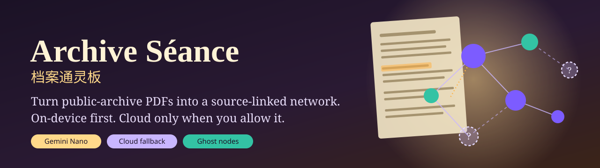
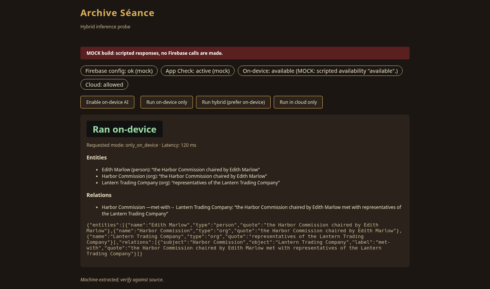
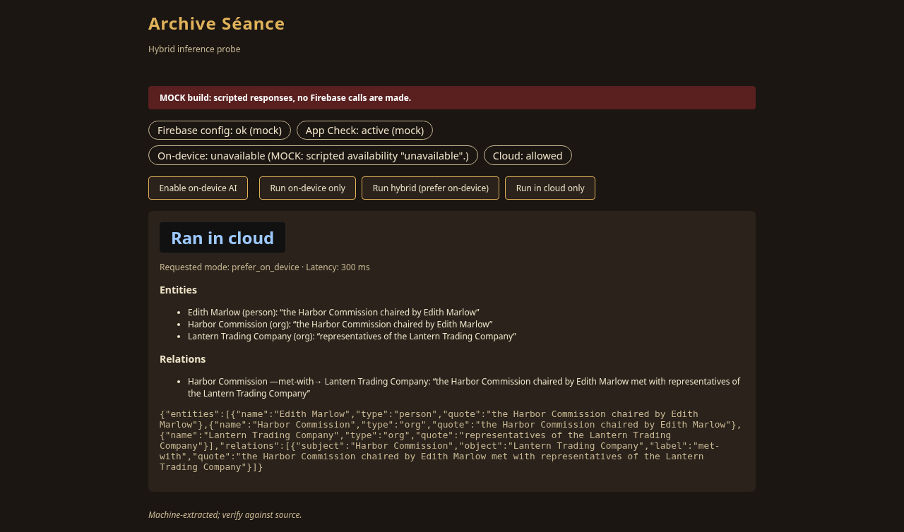
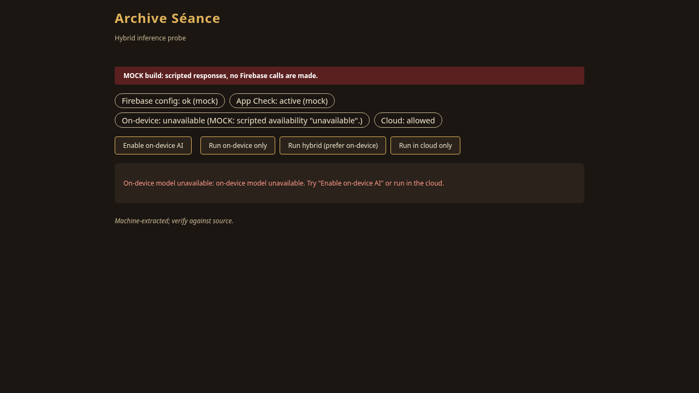
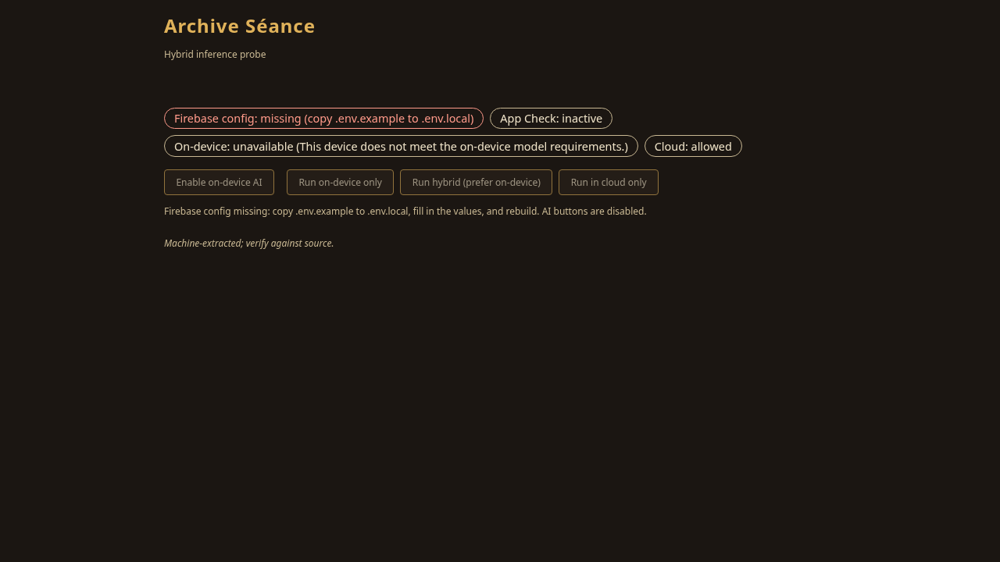
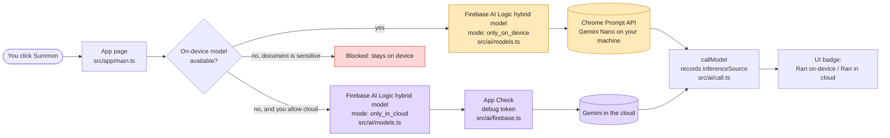

**English** | [简体中文](README.zh-CN.md)

<p align="center">
  
</p>

<p align="center">
  <a href="LICENSE"></a>
  
  
  
  
</p>

<p align="center">
  <b>Turn public-archive PDFs into a network you can check.</b><br>
  Every person, organization, and link points back to a quote in the source. On-device first.
</p>

<p align="center">
  <a href=".kiro/specs/archive-seance/requirements.md">Requirements</a> ·
  <a href=".kiro/specs/archive-seance/design.md">Design</a> ·
  <a href=".kiro/specs/archive-seance/tasks.md">Task plan</a> ·
  <a href="#where-firebase-ai-logic-is-called">Where Firebase AI Logic is called</a> ·
  <a href="#install">Install</a>
</p>

> **Status: early.** Task T01 is done: the extension shell and one working hybrid inference call that shows whether it ran on-device or in the cloud. PDF parsing, extraction, the D3 network, and jump-to-source are specified but not built yet. See [What works today](#what-works-today).

## What you see today

These screenshots come from the extension loaded into Chromium. The first three use the scripted **mock** build (a red MOCK banner is always visible), because Gemini Nano and a Firebase project are not available on the machine that took them.

| On-device path | Cloud fallback | Blocked, no silent cloud |
|---|---|---|
|  |  |  |
| `ONLY_ON_DEVICE` ran on Gemini Nano. | `PREFER_ON_DEVICE` found no local model and ran in the cloud. | `ONLY_ON_DEVICE` fails with a message. It never falls back to the cloud. |

The real build, with no Firebase config, shows what is missing and disables the AI buttons:



## Why it exists

Archive PDFs are hard to read as a whole. You can read each page, but you cannot see who connects to whom. A generic AI summary does not fix that, because you cannot check it.

Archive Séance builds the network and keeps the evidence attached:

- **Evidence or nothing.** A node or edge exists only if code located a verbatim quote (page and character offsets) in the PDF.
- **AI judges, code computes.** The model reads language. Code does offsets, counts, merge scores, confidence, routing, and redaction.
- **Private by default.** A document starts as `sensitive` and stays on your device. The cloud is opt-in per document, after you see the exact text that would leave.
- **Ghost nodes.** When two mentions might be the same person, the merge shows a translucent node with a dashed ring. You confirm or split it.

Machine-extracted output. Verify against the source.

## How hybrid inference works



The router that picks the path for each chunk (`decideRoute`, task T16) is specified in [design section 5.2](.kiro/specs/archive-seance/design.md) and not built yet. Today you pick the mode with a button. The rest of the diagram is how the code behaves now.

| Button in the app page | `InferenceMode` | If the on-device model is missing |
|---|---|---|
| Run on-device only | `ONLY_ON_DEVICE` | Fails with a message. No cloud call. |
| Run hybrid (prefer on-device) | `PREFER_ON_DEVICE` | Runs in the cloud. The badge says so. |
| Run in cloud only | `ONLY_IN_CLOUD` | Not affected. |

The badge text comes from `response.inferenceSource`, which the SDK sets. The app never guesses it.

## From PDF to network

```mermaid
flowchart LR
  PDF[Public-archive PDF<br/>with a text layer] --> IDX[Page text index<br/>page + character offsets]
  IDX --> CH[Chunker<br/>never crosses a page]
  CH --> LLM[Hybrid model call<br/>JSON schema output<br/>entities + relations + verbatim quotes]
  LLM --> LOC[locateQuote<br/>code finds the offsets]
  LOC -->|quote not found| DROP[Dropped and counted]
  LOC -->|quote found| MEN[Mentions with anchors]
  MEN --> MERGE[Merge and confidence<br/>code, not the model]
  MERGE -->|score above auto threshold| SOLID[Solid node]
  MERGE -->|between ghost and auto| GHOST[Ghost node<br/>dashed ring, translucent]
  SOLID --> GRAPH[D3 network]
  GHOST --> GRAPH
  GRAPH -->|click a node or edge| JUMP[Jump to the quote in the PDF]
  classDef built fill:#d8f5df,stroke:#2e8b57,color:#222;
  classDef planned fill:#eee,stroke:#999,stroke-dasharray:4 3,color:#333;
  class LLM built;
  class IDX,CH,LOC,MEN,MERGE,SOLID,GHOST,GRAPH,JUMP,DROP planned;
```



Green is built (the model call and its JSON schema). Dashed grey is specified in [`.kiro/specs/archive-seance/`](.kiro/specs/archive-seance/tasks.md) and not built yet.

## Where Firebase AI Logic is called

| What happens | File and function | SDK call |
|---|---|---|
| Start Firebase, App Check, and the AI Logic service | [`src/ai/firebase.ts`](src/ai/firebase.ts) `initFirebase` | `initializeApp`, `initializeAppCheck` (before anything else), `getAI` with `GoogleAIBackend` |
| Build a hybrid model for a mode | [`src/ai/models.ts`](src/ai/models.ts) `makeModel` | `getGenerativeModel(ai, { mode, onDeviceParams, inCloudParams })` |
| Send the one extraction request | [`src/ai/hybridProbe.ts`](src/ai/hybridProbe.ts) `runHybridProbe`, through [`src/ai/call.ts`](src/ai/call.ts) `callModel` | `model.generateContent(prompt)`, then `response.inferenceSource` |
| Download Gemini Nano after a click | [`src/ai/hybridProbe.ts`](src/ai/hybridProbe.ts) `initDeviceModel`, wired in [`src/app/realController.ts`](src/app/realController.ts) | `model.initializeDeviceModel(onProgress)` |
| One JSON schema for both paths | [`src/ai/schemas.ts`](src/ai/schemas.ts) | Same object as `responseConstraint` (on-device) and `responseSchema` (cloud) |

`initializeDeviceModel` runs only from the **Enable on-device AI** click handler, because Chrome requires a user gesture to download the model.

## What works today

| Area | Status | How it was checked |
|---|---|---|
| MV3 shell: manifest, service worker, app page | Built | Loaded in Chromium with `--load-extension` (Playwright). |
| Hybrid call with mode choice and `inferenceSource` badge | Built | Unit tests with a mocked Firebase layer. Scripted mock build in Chromium. |
| App Check debug provider, no reCAPTCHA in the bundle | Built | Unit tests. `npm run check:bundle-rhc` on `dist/`. |
| Secret guard for tracked files and git history | Built | `npm run check:secrets`. |
| Real Gemini Nano inference | **Not verified** | Needs Chrome 139+ with the model downloaded on a supported machine. |
| Real cloud inference through Firebase and App Check | **Not verified** | Needs a Firebase project with AI Logic and an App Check debug token. |
| PDF loading, local extraction and merge (console demo) | Built (mock verified) | Unit tests plus offline Playwright e2e on `dist-mock/` with `harbor-eval-minutes.pdf`. Real on-device Nano on a demo PDF is not yet verified (Alex, Chrome). |
| D3 graph, jump-to-source | Not built | See the [task plan](.kiro/specs/archive-seance/tasks.md) (T22–T23). |

## Install

You need Node.js 20 or later and Chrome 139 or later. Gemini Nano also needs enough disk space and a supported GPU or CPU (see [Chrome Prompt API docs](https://developer.chrome.com/docs/ai/prompt-api)).

**Try it without Firebase (scripted mock).**

1. Clone the repository and open it: `git clone https://github.com/alexxhchen-nu/archive-seance.git && cd archive-seance`.
2. Install dependencies: `npm ci`.
3. Build the mock flavor: `npm run build:mock`.
4. Open `chrome://extensions`, turn on **Developer mode**, click **Load unpacked**, and choose the `dist-mock/` folder.
5. Click the Archive Séance toolbar icon. Add `?device=unavailable` to the page URL to script a machine with no Gemini Nano.
6. In **Console demo (debug)**, open `test/fixtures/eval/harbor-eval-minutes.pdf` and click **Summon**. You should see solid and ghost entities (confidence, page + quote) and a JSON dump, with **Copy JSON** / **Download JSON**.

**Run it against your own Firebase project.**

1. In the Firebase console, create a project, turn on **AI Logic** with the Gemini Developer API, and register a web app.
2. Copy `.env.example` to `.env.local`, then fill in `VITE_FIREBASE_API_KEY`, `VITE_FIREBASE_PROJECT_ID`, and `VITE_FIREBASE_APP_ID`. Leave `VITE_APPCHECK_DEBUG_TOKEN` empty the first time.
3. Run `npm run build` and load `dist/` as an unpacked extension.
4. Open the app page and the DevTools console. The SDK prints an App Check debug token. Register it under **App Check → Apps → Manage debug tokens**, then paste it into `.env.local` and rebuild.
5. Click **Enable on-device AI** if needed (or just **Summon** — that click may also initialize the model), open a demo PDF, and click **Summon** in the console demo card. The three probe buttons still exercise hybrid modes.

`.env.local` is ignored by git. Never commit a debug token, an API key, or a service-account key.

## Develop

| Command | What it does |
|---|---|
| `npm run dev` | Rebuild `dist/` on change (development mode). |
| `npm run build` | Type-check, then build `dist/`. |
| `npm run build:mock` | Build `dist-mock/` with the scripted Firebase layer. |
| `npm run typecheck` | Run `tsc --noEmit` in strict mode. |
| `npm run lint` | Run ESLint (flat config, typescript-eslint recommended). |
| `npm test` | Run the Vitest unit and property tests (36 tests in 10 files). |
| `npm run check:secrets` | Fail on API-key shapes, debug-token literals, committed `.env*`, or `.kiro` in `.gitignore`. |
| `npm run check:bundle-rhc` | Fail if `dist/` contains remote reCAPTCHA or Google API scripts (Chrome Web Store MV3 rule). |
| `npm run e2e` | Load `dist/` and `dist-mock/` into headless Chromium and check the app page. Build both first. |

<details>
<summary>Repository layout</summary>

```
.kiro/                 specs, steering, hooks (committed, never ignored)
public/manifest.json   MV3 manifest
src/background/sw.ts   toolbar click opens the app page
src/app/               app page: panel, store, real and mock wiring
src/ai/                firebase, models, schemas, call, availability, hybridProbe, mock
src/config/            defaults and env reading
scripts/               check-secrets, check-bundle-rhc, e2e-extension
test/unit/             Vitest tests, mirroring src/
docs/images/           hero banner and screenshots
docs/diagrams/         Mermaid sources for the diagrams above
```

</details>

## Privacy and limits

- All AI calls run in the app page, never in the service worker.
- Production attestation for App Check is out of scope. The extension uses the App Check debug provider only, and it does not bundle reCAPTCHA.
- English text PDFs only in version 1. Scanned PDFs (OCR) are cut-first.

## Roadmap

The full plan, with dates, is in [`tasks.md`](.kiro/specs/archive-seance/tasks.md). Next: types and schemas, PDF loading, page index, chunker (T11 to T14), then the router and extraction pipeline (T15 to T17).

## License

[Apache-2.0](LICENSE). Third-party notices are in [`NOTICE`](NOTICE) and [`THIRD_PARTY.md`](THIRD_PARTY.md). All code was written on or after 2026-10-30.
