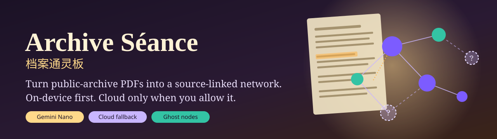
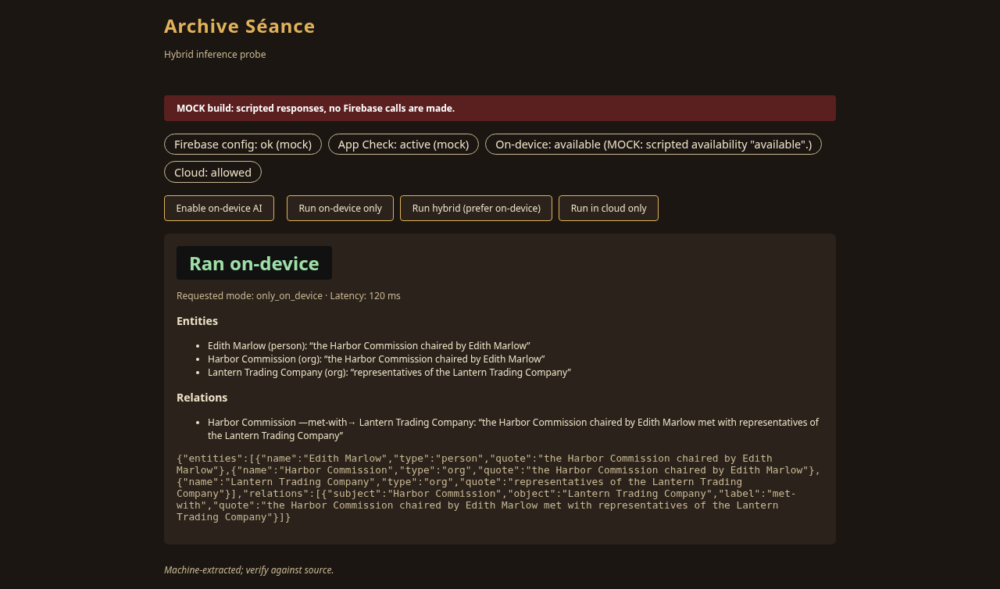
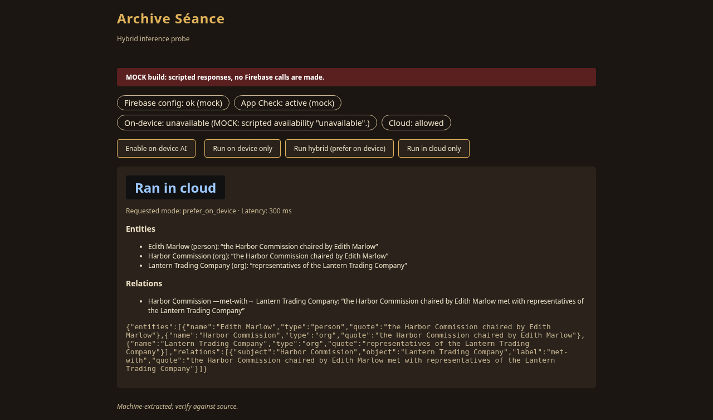
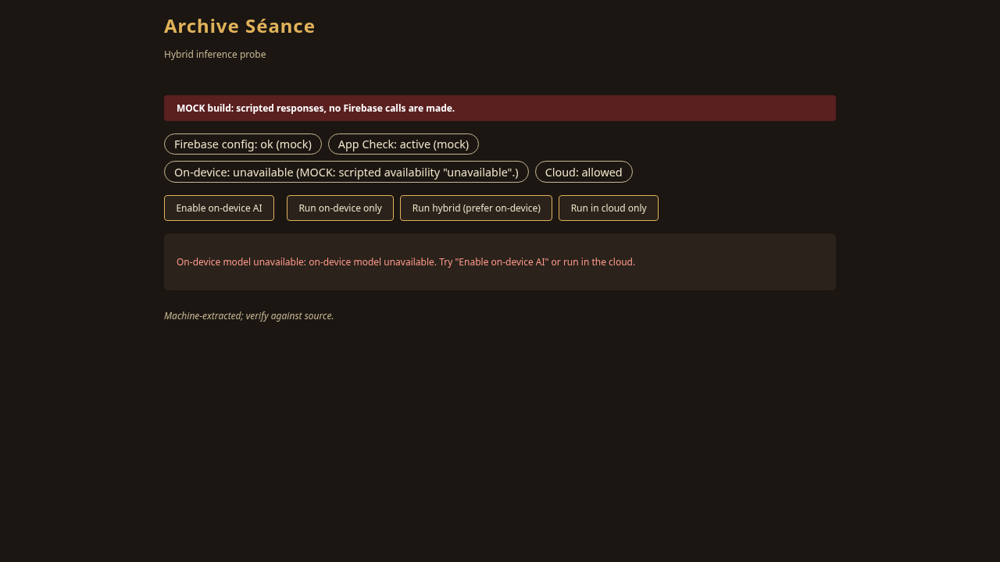
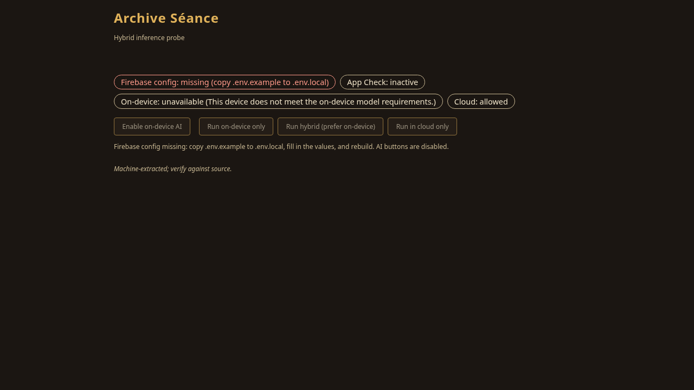
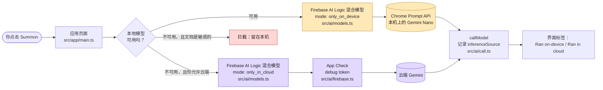
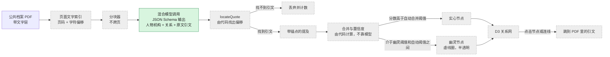

[English](README.md) | **简体中文**

<p align="center">
  
</p>

<p align="center">
  <a href="LICENSE"></a>
  
  
  
  
</p>

<p align="center">
  <b>把公共档案 PDF 变成一张可以核对的关系网。</b><br>
  每个人物、机构和关系都能跳回原文里的一句引文。优先在本机运行。
</p>

<p align="center">
  <a href=".kiro/specs/archive-seance/requirements.md">需求</a> ·
  <a href=".kiro/specs/archive-seance/design.md">设计</a> ·
  <a href=".kiro/specs/archive-seance/tasks.md">任务计划</a> ·
  <a href="#firebase-ai-logic-在哪里被调用">Firebase AI Logic 在哪里被调用</a> ·
  <a href="#安装">安装</a>
</p>

> **状态：早期。** 任务 T01 已完成：扩展外壳，加上一次可用的混合推理调用，界面会显示这次调用走的是本地还是云端。PDF 解析、抽取、D3 关系网和点击跳回原文都已写进规格，但还没有实现。见[目前能用的部分](#目前能用的部分)。

## 现在能看到什么

下面的截图来自装进 Chromium 的扩展。前三张用的是带脚本的 **mock** 构建（页面上始终有红色 MOCK 横幅），因为拍摄的机器上没有 Gemini Nano，也没有 Firebase 项目。

| 本地路径 | 云端兜底 | 被拦下，不会悄悄走云端 |
|---|---|---|
|  |  |  |
| `ONLY_ON_DEVICE` 在 Gemini Nano 上运行。 | `PREFER_ON_DEVICE` 找不到本地模型，改走云端。 | `ONLY_ON_DEVICE` 会报错并给出提示，绝不回退到云端。 |

真实构建在没有 Firebase 配置时，会提示缺什么，并禁用 AI 按钮：



## 为什么做它

档案 PDF 很难整体读懂。你能一页一页读，却看不出谁和谁有关。通用的 AI 摘要也解决不了，因为你没法核对它。

档案通灵板把关系网画出来，并把证据一直挂在上面：

- **没有证据就没有节点。** 只有代码在 PDF 里定位到一句原文引文（页码和字符偏移），才会出现节点或连线。
- **AI 判断，代码计算。** 模型负责读懂语言。偏移、计数、合并分数、置信度、路由和脱敏都由代码完成。
- **默认保护隐私。** 文档起初标为 `sensitive`（敏感），只在你的设备上处理。要用云端，须逐个文档同意，并且先看到将要发出去的原文。
- **幽灵节点。** 两处提及可能是同一个人时，合并结果用半透明、虚线圈的节点表示，由你确认或拆开。

内容由机器抽取，请对照原文核实。

## 混合推理如何工作



为每个文本块选路径的路由器（`decideRoute`，任务 T16）写在[设计文档第 5.2 节](.kiro/specs/archive-seance/design.md)，还没有实现。现在由你用按钮选择模式。图里其余部分就是当前代码的行为。

| 应用页面上的按钮 | `InferenceMode` | 本地模型缺失时 |
|---|---|---|
| Run on-device only | `ONLY_ON_DEVICE` | 报错并提示，不会调用云端。 |
| Run hybrid (prefer on-device) | `PREFER_ON_DEVICE` | 改走云端，标签会如实显示。 |
| Run in cloud only | `ONLY_IN_CLOUD` | 不受影响。 |

标签文字来自 SDK 设置的 `response.inferenceSource`，应用不会自己猜。

## 从 PDF 到关系网



绿色表示已实现（模型调用及其 JSON Schema）。灰色虚线表示已写进 [`.kiro/specs/archive-seance/`](.kiro/specs/archive-seance/tasks.md)、尚未实现。

## Firebase AI Logic 在哪里被调用

| 做什么 | 文件和函数 | SDK 调用 |
|---|---|---|
| 启动 Firebase、App Check 和 AI Logic 服务 | [`src/ai/firebase.ts`](src/ai/firebase.ts) `initFirebase` | `initializeApp`，随后 `initializeAppCheck`（先于其他调用），再 `getAI`（`GoogleAIBackend`） |
| 按模式创建混合模型 | [`src/ai/models.ts`](src/ai/models.ts) `makeModel` | `getGenerativeModel(ai, { mode, onDeviceParams, inCloudParams })` |
| 发出那一次抽取请求 | [`src/ai/hybridProbe.ts`](src/ai/hybridProbe.ts) `runHybridProbe`，经 [`src/ai/call.ts`](src/ai/call.ts) `callModel` | `model.generateContent(prompt)`，然后读取 `response.inferenceSource` |
| 点击后下载 Gemini Nano | [`src/ai/hybridProbe.ts`](src/ai/hybridProbe.ts) `initDeviceModel`，在 [`src/app/realController.ts`](src/app/realController.ts) 里接线 | `model.initializeDeviceModel(onProgress)` |
| 两条路径共用一份 JSON Schema | [`src/ai/schemas.ts`](src/ai/schemas.ts) | 同一个对象既作 `responseConstraint`（本地）又作 `responseSchema`（云端） |

`initializeDeviceModel` 只会在 **Enable on-device AI** 的点击处理函数里运行，因为 Chrome 要求用户操作之后才能下载模型。

## 目前能用的部分

| 部分 | 状态 | 如何验证 |
|---|---|---|
| MV3 外壳：manifest、service worker、应用页面 | 已实现 | 用 Playwright 以 `--load-extension` 装进 Chromium。 |
| 可选模式的混合调用和 `inferenceSource` 标签 | 已实现 | 用模拟的 Firebase 层做单元测试；在 Chromium 里跑带脚本的 mock 构建。 |
| App Check debug provider，打包产物里没有 reCAPTCHA | 已实现 | 单元测试；对 `dist/` 运行 `npm run check:bundle-rhc`。 |
| 针对已跟踪文件和 git 历史的密钥检查 | 已实现 | `npm run check:secrets`。 |
| 真实的 Gemini Nano 推理 | **未验证** | 需要在受支持的机器上用 Chrome 139+ 并下载好模型。 |
| 经 Firebase 和 App Check 的真实云端推理 | **未验证** | 需要开通 AI Logic 的 Firebase 项目和 App Check debug token。 |
| PDF 加载、抽取流程、合并、D3 关系网、跳回原文 | 未实现 | 见[任务计划](.kiro/specs/archive-seance/tasks.md)。 |

## 安装

需要 Node.js 20 或更高版本，以及 Chrome 139 或更高版本。Gemini Nano 还要求足够的磁盘空间和受支持的 GPU 或 CPU，详见 [Chrome Prompt API 文档](https://developer.chrome.com/docs/ai/prompt-api)。

**不用 Firebase，先试 mock 版（带脚本）。**

1. 克隆仓库并进入目录：`git clone https://github.com/alexxhchen-nu/archive-seance.git && cd archive-seance`。
2. 安装依赖：`npm ci`。
3. 构建 mock 版：`npm run build:mock`。
4. 打开 `chrome://extensions`，打开**开发者模式**，点击**加载已解压的扩展程序**，选择 `dist-mock/` 文件夹。
5. 点击工具栏上的档案通灵板图标。在页面网址后加 `?device=unavailable`，可以模拟一台没有 Gemini Nano 的机器。

**用你自己的 Firebase 项目运行。**

1. 在 Firebase 控制台新建项目，用 Gemini Developer API 开启 **AI Logic**，并注册一个 Web 应用。
2. 把 `.env.example` 复制为 `.env.local`，填入 `VITE_FIREBASE_API_KEY`、`VITE_FIREBASE_PROJECT_ID` 和 `VITE_FIREBASE_APP_ID`。第一次先把 `VITE_APPCHECK_DEBUG_TOKEN` 留空。
3. 运行 `npm run build`，把 `dist/` 作为已解压扩展加载。
4. 打开应用页面和 DevTools 控制台。SDK 会打印一个 App Check debug token。到 **App Check → 应用 → 管理调试令牌**里登记它，再填进 `.env.local` 并重新构建。
5. 点击 **Enable on-device AI**（需要时会下载 Gemini Nano），然后依次点三个运行按钮，查看标签。

`.env.local` 已被 git 忽略。绝不要提交 debug token、API key 或服务账号密钥。

## 开发

| 命令 | 作用 |
|---|---|
| `npm run dev` | 文件变化时重新构建 `dist/`（开发模式）。 |
| `npm run build` | 先类型检查，再构建 `dist/`。 |
| `npm run build:mock` | 用带脚本的 Firebase 层构建 `dist-mock/`。 |
| `npm run typecheck` | 以严格模式运行 `tsc --noEmit`。 |
| `npm run lint` | 运行 ESLint（flat config，typescript-eslint recommended）。 |
| `npm test` | 运行 Vitest 单元测试和属性测试（10 个文件共 36 个测试）。 |
| `npm run check:secrets` | 发现 API key 形态、debug token 字面量、被提交的 `.env*`，或 `.gitignore` 里出现 `.kiro` 时失败。 |
| `npm run check:bundle-rhc` | 如果 `dist/` 里有远程 reCAPTCHA 或 Google API 脚本则失败（Chrome 应用商店 MV3 规则）。 |
| `npm run e2e` | 把 `dist/` 和 `dist-mock/` 装进无头 Chromium，检查应用页面。需先构建两者。 |

<details>
<summary>仓库结构</summary>

```
.kiro/                 规格、steering、hooks（已提交，绝不忽略）
public/manifest.json   MV3 manifest
src/background/sw.ts   点击工具栏图标打开应用页面
src/app/               应用页面：面板、store、真实与 mock 接线
src/ai/                firebase、models、schemas、call、availability、hybridProbe、mock
src/config/            默认值与环境变量读取
scripts/               check-secrets、check-bundle-rhc、e2e-extension
test/unit/             Vitest 测试，目录与 src/ 对应
docs/images/           顶部横幅和截图
docs/diagrams/         上面图表的 Mermaid 源文件
```

</details>

## 隐私与限制

- 所有 AI 调用都在应用页面里运行，不在 service worker 里。
- App Check 的正式环境证明不在范围内。扩展只使用 App Check debug provider，也不打包 reCAPTCHA。
- 第一版只支持英文文字层 PDF。扫描件（OCR）最先砍掉。

## 路线图

带日期的完整计划在 [`tasks.md`](.kiro/specs/archive-seance/tasks.md)。接下来：类型与 Schema、PDF 加载、页面索引、分块器（T11 到 T14），然后是路由器和抽取流程（T15 到 T17）。

## 许可证

[Apache-2.0](LICENSE)。第三方声明见 [`NOTICE`](NOTICE) 和 [`THIRD_PARTY.md`](THIRD_PARTY.md)。所有代码均写于 2026-10-30 或之后。
